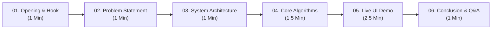
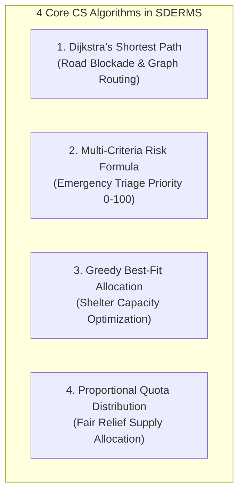

# 🛡️ Smart Disaster & Emergency Resource Management System (SDERMS)

[](https://www.python.org/)
[](https://customtkinter.tomschimansky.com/)
[](https://www.sqlite.org/)
[]()
[]()

> **Academic Project Submission for SDP-200 (Software Development Project)**  
> **Department of Computer Science and Engineering (CSE)**  
> **Bangladesh University of Business and Technology (BUBT)**

---

## 👥 Academic & Team Information

- **Course Title:** Software Development Project (SDP-200)
- **Submitted To:** **Ashfia Jannat Keya**, Lecturer, Dept. of CSE, BUBT
- **Intake / Section:** 48 / 2

| Student ID | Full Name | Role |
| :--- | :--- | :--- |
| **20255203047** | **Md Maruf Hossain** | **Team Leader / Presenter** |
| 20255203050 | Masud Rana | Co-Leader |
| 20255203052 | MD. Mahabur Rahman Muhin | Member |
| 20255203055 | Sumaiya Afroz | Member |
| 20255203057 | Urmi Akther | Member |
| 20255203125 | Nazmus Sakib Junayed | Member |

---

## 🚀 Multi-Platform App Downloads & Live Web Access (সব ডিভাইসে চালানোর উপায়)

এই প্রজেক্টটি যেকোনো ডিভাইস (Mac, Windows, Android ফোন, এবং Web Browser)-এ কোনো কোড রান করা ছাড়াই সরাসরি অ্যাপ হিসেবে চালানো যায়:

| Platform | Format / Access | Deployment / Run Method | Status |
| :--- | :--- | :--- | :--- |
| 🍎 **Apple MacBook (macOS)** | **Native `.app` / `.zip`** | Double-click `dist/SDERMS.app` (বা `open dist/SDERMS.app`) | ✅ Ready in repo (`dist/`) |
| 🪟 **Windows Laptop / PC** | **Standalone `.exe`** | [GitHub Actions Artifacts](https://github.com/maruf010/smart-disaster-system/actions) থেকে ডাউনলোড | ☁️ Auto-built via Cloud CI |
| 🌐 **Live Web Cloud Portal** | **Cloud Web App** | [Streamlit Community Cloud](https://share.streamlit.io) (100% Free Live URL) | 🚀 1-Click Deploy (`app.py`) |
| 📱 **Android Mobile** | **Mobile APK / PWA** | Web-to-APK (AppsGeyser/Web2Apk) বা Chrome "Install App" | 📲 Instant Install |

---

### 1. 🍎 MacBook এ সরাসরি অ্যাপ চালানোর নিয়ম (Native macOS `.app`)
- এই প্রজেক্টের `dist/` ফোল্ডারে সম্পূর্ণ স্বয়ংসম্পূর্ণ macOS App বিল্ড করা আছে।
- কোনো Python বা Terminal ছাড়াই সাধারণ অ্যাপের মতো চালাতে:
  1. Finder দিয়ে প্রজেক্টের `dist/` ফোল্ডারে যান।
  2. **`SDERMS.app`** ফাইলে ডাবল-ক্লিক করুন।
  3. অথবা টার্মিনালে কমান্ড দিন:
     ```bash
     open dist/SDERMS.app
     ```
  *(পেনড্রাইভে বা গুগলে ড্রাইভে কাউকে দিতে চাইলে `dist/SDERMS-MacOS.zip` ফাইলটি শেয়ার করুন)*

---

### 2. 🪟 Windows ল্যাপটপ বা ডেস্কটপে চালানোর নিয়ম (`.exe` Executable)
- **GitHub Actions Cloud থেকে ডাউনলোড (রিকমেন্ডেড):**
  1. GitHub রিপোজিটরির [Actions ট্যাবে](https://github.com/maruf010/smart-disaster-system/actions) যান।
  2. সর্বশেষ **"Build Executables for Windows and Mac"** বিল্ডটিতে ক্লিক করুন।
  3. নিচে **Artifacts** থেকে **`SDERMS-Windows-App`** জিপ ফাইলটি ডাউনলোড করে আনজিপ করুন।
  4. প্রাপ্ত **`SDERMS_Windows.exe`** ফাইলে ডাবল-ক্লিক করলেই উইন্ডোজে সরাসরি সফটওয়্যারটি রান হবে।
- **অথবা কোনো উইন্ডোজ পিসিতে লোকালি বিল্ড করতে চাইলে:**
  ```cmd
  pip install pyinstaller customtkinter pillow
  pyinstaller --name "SDERMS" --windowed --noconfirm --collect-all customtkinter --add-data "database;database" gui_main.py
  ```

---

### 3. 🌐 লাইভ ওয়েব ক্লাউড পোর্টাল (Streamlit Cloud - 100% Free)
- শিক্ষক বা যেকোনো ইউজারকে মোবাইল বা ল্যাপটপের যেকোনো ব্রাউজারে লাইভ প্রজেক্ট দেখাতে:
  1. [share.streamlit.io](https://share.streamlit.io) এ যান (GitHub দিয়ে সাইন-ইন করুন)।
  2. **"New app"** এ ক্লিক করে ফিল্ডগুলো দিন:
     - **Repository:** `maruf010/smart-disaster-system`
     - **Branch:** `main`
     - **Main file path:** `app.py`
  3. **"Deploy!"** এ ক্লিক করুন — ১ মিনিটের মধ্যে আপনার একটি ফ্রি লাইভ লিংক (যেমন `https://...streamlit.app`) জেনারেট হয়ে যাবে।

---

### 4. 📱 Android ফোনে মোবাইল অ্যাপ (`.apk` / PWA)
- **পদ্ধতি ১ (আসল `.apk` ফাইল জেনারেট):**
  1. [AppsGeyser](https://appsgeyser.com) বা [Web2Apk](https://web2apk.com) এ যান।
  2. আপনার Streamlit লাইভ ওয়েবসাইট লিংকটি দিন এবং নাম দিন **SDERMS**।
  3. **"Generate APK"** তে ক্লিক করলে সরাসরি ডাউনলোডযোগ্য `.apk` ফাইল পেয়ে যাবেন যা যেকোনো ফোনে ইন্সটল করা যায়।
- **পদ্ধতি ২ (১ ক্লিকে PWA Install):**
  1. অ্যান্ড্রয়েডের Google Chrome ব্রাউজারে আপনার লাইভ ওয়েবসাইটটি খুলুন।
  2. ৩-ডট মেনু (⋮) থেকে **"Install app"** বা **"Add to Home screen"** চাপুন।
  3. ফোনের হোমস্ক্রিনে আসল মোবাইল অ্যাপের মতো আইকন চলে আসবে এবং ফুলস্ক্রিনে চালু হবে।

---

### 5. 💻 সোর্স কোড থেকে লোকালি রান করার কমান্ড (Developer Mode)
```bash
# ডেস্কটপ ডার্ক-মোড GUI (CustomTkinter):
python3 gui_main.py

# ক্লাউড ওয়েব পোর্টাল (Streamlit):
streamlit run app.py
```

---

# 🎤 FULL PRESENTATION GUIDE & SCRIPT (START TO END)
### প্রেজেন্টেশনে শুরু থেকে শেষ পর্যন্ত কী বলবেন, কীভাবে উপস্থাপন করবেন এবং কী ডেমো দেখাবেন (বাংলা ও ইংরেজি উভয় ভাষায় সাজানো)

---

## ⏱️ Presentation Timeline (৫ থেকে ৮ মিনিটের আদর্শ টাইমলাইন)



---

## 📍 PHASE 1: Introduction & Opening (শুরু ও পরিচয়)

### 🗣️ English Script (কীভাবে ইংরেজিতে শুরু করবেন):
> *"Honorable Course Teacher, Respected Supervisor, and my dear classmates, Good day!  
> I am **Md Maruf Hossain**, Team Leader for group from Intake 48, Section 2. Today, our team is presenting our SDP-200 Software Development Project titled:  
> **'SDERMS: Smart Disaster & Emergency Resource Management System'**.  
> In our country, natural calamities like flash floods, cyclones, and urban building fires create severe post-disaster chaos. Our project provides an intelligent, algorithm-driven desktop command platform that bridges the gap between affected citizens and central rescue operations."*

### 🇧🇩 বাংলা অর্থ ও উপস্থাপনার টিপস:
- **কীভাবে বলবেন:** আত্মবিশ্বাসের সাথে সালাম/গ্রিটিংস দিয়ে শুরু করবেন। নিজের নাম এবং প্রজেক্টের নাম পরিষ্কারভাবে বলবেন।
- **মূল কথা:** আমাদের দেশ বাংলাদেশ বন্যা, ঘূর্ণিঝড় ও অগ্নিকাণ্ডের মতো দুর্যোগপ্রবণ দেশ। দুর্যোগের সময় সাধারণ মানুষ এবং রেসকিউ টিমগুলোর মধ্যে সমন্বয় থাকে না। এই সমস্যা সমাধানের জন্যই আমরা **SDERMS** ডেভেলপ করেছি।

---

## 📍 PHASE 2: Problem Statement & Motivation (কেন এই প্রজেক্ট?)

### 🗣️ English Script:
> *"During disaster situations in Bangladesh, responders face five critical bottlenecks:  
> 1. **Manual & Fragmented Incident Logging:** SOS calls get lost in paperwork.  
> 2. **Absence of Mathematical Triage:** There is no objective scoring engine to prioritize life-threatening incidents over minor ones.  
> 3. **Shelter Overcrowding:** People rush to familiar shelters, causing 200% overcrowding while adjacent shelters stay vacant.  
> 4. **Unfair Relief Distribution:** Relief aid is distributed randomly instead of population-proportional equity.  
> 5. **Hazard-Blind Navigation:** Road blockades and floods make conventional maps fail when ambulances dispatch.  
> **SDERMS solves all five challenges** through automated computer science algorithms and a dual-panel architecture."*

### 🇧🇩 বাংলা ব্যাখ্যা:
- দুর্যোগের সময় সবচেয়ে বড় সমস্যা হয় ৫টি:
  1. জরুরি কলগুলো খাতায় লিখে রাখা হয়, ফলে অনেক কল হারিয়ে যায়।
  2. কোন রোগীকে আগে বাঁচানো দরকার—তা গাণিতিকভাবে নির্ণয় করা যায় না।
  3. পরিচিত কোনো আশ্রয়কেন্দ্রে উপচে পড়া ভিড় হয়, কিন্তু পাশের অন্য কেন্দ্র খালি থাকে।
  4. ত্রাণ সমানুপাতিক হারে যায় না, কোথাও অতিরিক্ত ত্রাণ যায় আর কোথাও অনাহার।
  5. রাস্তা পানিতে ডুবে বা ভেঙে গেলে উদ্ধারকারী দল বুঝতে পারে না কোন বিকল্প পথ দিয়ে দ্রুত পৌঁছাবে।

---

## 📍 PHASE 3: System Architecture & Dual Portals (সিস্টেম আর্কিটেকচার)

### 🗣️ English Script:
> *"Our system is designed with a **Separation of Concerns** architecture featuring two dedicated user experiences:  
> - **1. Citizen Emergency Portal (Public User Panel):** Accessible by ordinary citizens. It allows victims to send real-time SOS requests, track dispatch status, search nearby safe shelters with live bed capacities, and enroll as community volunteers.  
> - **2. Admin Command Center (Disaster Control Room):** Restricted to disaster management authorities. It provides an Executive Dashboard, incident management, automated risk queue triage, greedy shelter matching, relief quota solvers, Dijkstra route navigation, and CSV audit reports."*

### 🇧🇩 বাংলা ব্যাখ্যা:
- সিস্টেমে ২টি আলাদা পোর্টাল রয়েছে:
  - **Citizen Portal (পাবলিক ইউজার প্যানেল):** বিপদে পড়া সাধারণ নাগরিক লগইন করে জরুরি SOS পাঠাতে পারেন, আশ্রয়কেন্দ্রে কয়টি সিট খালি আছে দেখতে পারেন এবং স্বেচ্ছাসেবী হিসেবে নাম নিবন্ধন করতে পারেন।
  - **Admin Command Center (কন্ট্রোল রুম প্যানেল):** প্রশাসন বা উদ্ধারকারী কর্তৃপক্ষ রিয়েল-টাইম ড্যাশবোর্ড থেকে সিদ্ধান্ত গ্রহণ, ফিল্ডে টিম পাঠানো এবং রাস্তাঘাটের পরিস্থিতি পর্যবেক্ষণ করতে পারেন।

---

## 📍 PHASE 4: Core Algorithms (প্রজেক্টে ব্যবহৃত ৪টি মূল অ্যালগরিদম)
> 💡 *প্রেজেন্টেশনে শিক্ষকরা অ্যালগরিদম নিয়ে সবচেয়ে বেশি প্রশ্ন করেন। এই অংশটি খুব মনোযোগ দিয়ে মুখস্থ রাখবেন।*



### 1. Multi-Criteria Risk Scoring Formula (জরুরি অবস্থার অগ্রাধিকার নির্ণয়)
- **উদ্দেশ্য:** ইনকামিং SOS কলগুলোকে ০ থেকে ১০০ স্কোরের মধ্যে স্বয়ংক্রিয়ভাবে র‍্যাংক করা।
- **গাণিতিক সূত্র:**
  $$\text{Score} = (0.40 \times \text{Severity} \times 20) + (0.35 \times \min(100, \text{Casualties} \times 2)) + (0.25 \times \text{Urgency Weight})$$
  - যদি **Life Threat** থাকে: অতিরিক্ত ১৫ পয়েন্ট যোগ হয়।
  - যদি **Resource Shortage** থাকে: অতিরিক্ত ১০ পয়েন্ট যোগ হয়।
- **লেভেল ক্লাসিফিকেশন:**
  - $\ge 75$: **CRITICAL** (তাৎক্ষণিক অ্যাম্বুলেন্স পাঠানো হয়)
  - $50 - 74$: **HIGH**
  - $30 - 49$: **MODERATE**
  - $< 30$: **LOW**

### 2. Dijkstra's Shortest Path Algorithm (রোড ব্লকেজ ও নিরাপদ রুট নির্ণয়)
- **উদ্দেশ্য:** অ্যাম্বুলেন্স বা ত্রাণবাহী ট্রাক সবচেয়ে কম সময়ে এবং ব্লকেড রাস্তা এড়িয়ে কীভাবে গন্তব্যে পৌঁছাবে তা নির্ণয় করা।
- **ডাটা স্ট্রাকচার:** Weighted Adjacency List + Min-Heap Priority Queue ($O((V + E) \log V)$)।
- **স্পেশালিটি:** কন্ট্রোল রুম থেকে কোনো রাস্তা "BLOCKED" মার্ক করলে অ্যালগরিদম স্বয়ংক্রিয়ভাবে ওই নোড/এজ এড়িয়ে বিকল্প নিরাপদ শর্টেস্ট রুট বের করে দেয়।

### 3. Greedy Best-Fit Shelter Recommender (আশ্রয়কেন্দ্রের ধারণক্ষমতা অপ্টিমাইজেশন)
- **উদ্দেশ্য:** বড় আশ্রয়কেন্দ্রগুলো ছোট দলের পেছনে অপচয় না করে টাইটেস্ট-ফিট (Tightest-Fit) আশ্রয়কেন্দ্রে ভিকটিমদের পাঠানো।
- **লজিক:**
  $$\text{Target} = \arg\min_{s \in \text{Shelters}} \Big( \text{AvailableBeds}(s) - \text{RequiredPeople} \Big) \quad \text{subject to } \text{AvailableBeds}(s) \ge \text{RequiredPeople}$$
- এতে কোনো সেন্টার অতিরিক্ত উপচে পড়বে না এবং ক্যাপাসিটি অপচয় রোধ হবে।

### 4. Population-Proportional Relief Distribution (ত্রাণ বণ্টন অ্যালগরিদম)
- **উদ্দেশ্য:** ক্ষতিগ্রস্ত এলাকাগুলোর জনসংখ্যার অনুপাতে শতভাগ সুষ্ঠু ও সমবণ্টন নিশ্চিত করা।
- **গাণিতিক সূত্র:**
  $$\text{Allocated Quantity}(A_i) = \left\lfloor \frac{\text{Population}(A_i)}{\sum \text{Population}} \times \text{Total Inventory} \right\rfloor$$
- অবশিষ্ট ফ্র্যাকশনাল অংশ ফেয়ারলি রিমেইন্ডার পদ্ধতিতে রি-ডিস্ট্রিবিউট করা হয়, যাতে এক কেজিও অপচয় না হয়।

---

## 📍 PHASE 5: Live Demo Walkthrough (স্টেপ-বাই-স্টেপ প্র্যাকটিক্যাল ডেমো)
> 🖥️ *প্রজেক্ট রান করে স্ক্রিনে শিক্ষকদের সামনে কী কী ক্লিক করবেন:*

### Step 1: Login Window (লগইন স্ক্রিন)
- কমান্ড চালান: `python gui_main.py`
- দেখান:
  - আধুনিক, মিনিমালিস্ট সিঙ্গেল-কালার ইন্টারফেস।
  - উপরে **Citizen Login** এবং **Admin Login** ট্যাব।
  - বলুন: *"স্যার, এখানে পাবলিক অ্যাক্সেসের জন্য সিটিজেন মোড এবং রেস্ট্রিক্টেড কন্ট্রোল রুমের জন্য অ্যাডমিন মোড আলাদা করা আছে।"*

### Step 2: Citizen Emergency Portal (সিটিজেন প্যানেল)
- সিটিজেন লগইন করুন (বা নতুন অ্যাকাউন্ট ক্রিয়েট করুন)।
- **Tab 1: Send Emergency SOS:**
  - ভিকটিমের লোকেশন (যেমন: `Chittagong Port Node 3`), ক্যাজুয়াল্টি সংখ্যা (যেমন: `25`), আহত (`10`) দিন এবং `Life Threat` চেক করুন।
  - দেখান: রিয়েল-টাইমেই নিচে Risk Rating বার স্বয়ংক্রিয়ভাবে **CRITICAL (88/100)** হয়ে যায়!
  - Submit বাটনে ক্লিক করুন। টিকেট তৈরি হবে (যেমন: `ER-0012`)।
- **Tab 2: Track My Requests:**
  - রিয়েল-টাইমে টিকেট পেন্ডিং নাকি রেসকিউ টিম পাঠানো হয়েছে তা দেখায়।
- **Tab 3: Find Safe Shelters:**
  - ফিল্টার করুন "Available Only"। খালি সিটের সংখ্যা ও প্রগ্রেস বার দেখান।
- **Tab 4: Join as Volunteer:**
  - ফার্স্ট এইড বা স্পেশাল স্কিল দিয়ে ভলান্টিয়ার এনরোলমেন্ট দেখান।

### Step 3: Admin Command Center (অ্যাডমিন প্যানেল)
- সাইন আউট করে `admin` / `admin123` দিয়ে লগইন করুন।
- **Dashboard View:**
  - লাইভ KPI মেট্রিক্স: Active Disasters, Affected People, Critical Queue, Shelter Occupancy।
  - নিচে স্বয়ংক্রিয়ভাবে সিটিজেনের পাঠানো সেই হাই-প্রায়োরিটি SOS টিকিট সবার উপরে র‍্যাংক হয়ে প্রদর্শিত হচ্ছে।
- **Dijkstra Route Navigation (মাস্টারপিস ফিচার):**
  - Origin `1` এবং Destination `4` সিলেক্ট করে **Calculate Shortest Route** দিন (যেমন: `1 -> 2 -> 4`, Distance: 15 KM)।
  - এখন টেবিল থেকে রাস্তাটি `BLOCKED` করে দিন (যেমন বন্যা বা ভূমিধসে রাস্তা বন্ধ)।
  - আবার **Calculate** দিন; সাথে সাথে অ্যালগরিদম অন্য নিরাপদ বিকল্প পথ (যেমন: `1 -> 3 -> 4`) স্বয়ংক্রিয়ভাবে বের করে দেখাবে!
- **Shelter Best-Fit:**
  - রিকোয়ার্ড মানুষ দিন `150`। Best-Fit বাটনে ক্লিক করুন; সিস্টেম এমন শেল্টার সুপারিশ করবে যেখানে ক্যাপাসিটি নষ্ট না করে ঠিকঠাক জায়গা হবে।
- **Proportional Resource Solver:**
  - চাল বা স্যালাইন সিলেক্ট করে ৩টি এলাকার জনসংখ্যা দিন। ক্যালকুলেট করলে সিস্টেম জনসংখ্যার অনুপাতে কেজি বা প্যাকেট নির্ভুলভাবে বণ্টন করে দেবে।
- **Audit Reports:**
  - **Export CSV** দিন; এক ক্লিকে সম্পূর্ণ অডিট রিপোর্ট এক্সেল শিটে সেভ হয়ে যাবে।

---

## 📍 PHASE 6: Tech Stack & System Architecture

| Component | Technology | Rationale / সুবিধা |
| :--- | :--- | :--- |
| **Language** | Python 3.10+ | দ্রুত ডেভেলপমেন্ট, উন্নত ডেটা স্ট্রাকচার ও অ্যালগরিদম লাইব্রেরি। |
| **GUI Framework** | CustomTkinter | আধুনিক ফ্ল্যাট ডার্ক/লাইট মোড, স্মুথ স্কেলিং ও রেসপনসিভনেস। |
| **Icons & Graphics** | Pillow (PIL) Vector System | সম্পূর্ণ সিঙ্গেল-কালার, প্রফেশনাল, ক্রিস্প ভেক্টর আইকন রেন্ডারিং। |
| **Database** | SQLite3 (WAL Mode) | কোনো এক্সটারনাল সার্ভার ছাড়াই সম্পূর্ণ অফলাইন-রেডি, রিলেশনাল ট্রানজেকশন সাপোর্ট। |
| **Reporting** | Python `csv` Engine | সরকারি বা জাতিসংঘের দুর্যোগ নীতিমালার জন্য তাৎক্ষণিক ডেটা এক্সপোর্ট। |

---

## 📍 PHASE 7: Viva / Defense Questions & Answers (শিক্ষকদের সম্ভাব্য প্রশ্ন ও সেরা উত্তর)

#### ❓ প্রশ্ন ১: "তোমরা কেন ওয়েব অ্যাপ্লিকেশন না বানিয়ে ডেস্কটপ অ্যাপ্লিকেশন বানিয়েছ?"
> **উত্তরঃ**  
> *"স্যার, দুর্যোগপূর্ণ পরিস্থিতিতে (যেমন সাইক্লোন বা পাহাড়ি ঢলে) অনেক সময় মোবাইল নেটওয়ার্ক, ক্লাউড সার্ভার এবং ইন্টারনেট লাইন পুরোপুরি বিচ্ছিন্ন হয়ে যায়। আমাদের SDERMS সিস্টেমটি একটি স্ট্যান্ডঅ্যালোন লোকাল ডেটাবেজ অ্যাপ, যা বিদ্যুৎ বা ইন্টারনেট না থাকলেও কন্ট্রোল রুমের লোকাল জেনারেটর বা ব্যাটারি ব্যাকআপে শতভাগ কার্যকর থাকে।"*

#### ❓ প্রশ্ন ২: "Dijkstra অ্যালগরিদম এখানে কীভাবে কাজ করছে?"
> **উত্তরঃ**  
> *"স্যার, আমরা রোড নেটওয়ার্ককে একটি Weighted Graph হিসেবে ডিজাইন করেছি। প্রতিটি মোড়কে Vertex (Node) এবং সড়ককে Edge ধরেছি। যখন কোনো রাস্তা দুর্যোগে ব্লক হয়ে যায়, আমরা গ্রাফ থেকে সেই এজের ওয়েট ইনফিনিটি করে দিই বা এজ ফিল্টার করি। এরপর Dijkstra অ্যালগরিদম Min-Heap Priority Queue ব্যবহার করে $O((V+E)\log V)$ সময়ে সবচেয়ে কম দূরত্বের নিরাপদ রুট ক্যালকুলেট করে।"*

#### ❓ প্রশ্ন ৩: "রিস্ক স্কোরিং ফর্মুলার ওয়েটেজগুলো কীভাবে ঠিক করেছ?"
> **উত্তরঃ**  
> *"স্যার, দুর্যোগ ব্যবস্থাপনায় জীবনহানির ঝুঁকি এবং ক্যাজুয়াল্টি সবচেয়ে গুরুত্বপূর্ণ। তাই আমরা ইনসিডেন্টের সিভিয়ারিটিকে ৪০%, ক্যাজুয়াল্টি ও আক্রান্ত মানুষকে ৩৫% এবং জরুরিতা ও লজিস্টিক ঘাটতিকে ২৫% ওয়েট দিয়ে মোট ১০০-র স্কেলে গাণিতিক নরম্যালাইজেশন করেছি।"*

#### ❓ প্রশ্ন ৪: "প্রজেক্টের ইউনিক সেলিং পয়েন্ট (USP) কী?"
> **উত্তরঃ**  
> *"বিদ্যমান দুর্যোগ সফটওয়্যারগুলো (যেমন Sahana বা FEMA) শুধু তথ্য সংগ্রহ বা অতীতের রেকর্ড রাখে। কিন্তু আমাদের SDERMS দুর্যোগ চলাকালীন সময়ে রিয়েল-টাইমে ৪টি কোর অ্যালগরিদমের মাধ্যমে সিদ্ধান্ত গ্রহণে সরাসরি সাহায্য করে।"*

---

## 📍 PHASE 8: Conclusion (সমাপ্তি বক্তব্য)

### 🗣️ English Closing:
> *"To conclude, SDERMS is not just an academic prototype; it is a practical, resilient, and lifesaving decision-support architecture. By automating risk triage, resource allocation, and evacuation routing, it minimizes emergency response delay and optimizes relief efficiency.  
> Thank you so much for your valuable time and attention. We are now open for any questions."*

### 🇧🇩 বাংলা সমাপ্তি:
- ধন্যবাদ জানিয়ে শিক্ষকদের প্রশ্ন করার আমন্ত্রণ জানাবেন: *"স্যার, আমাদের প্রজেক্ট নিয়ে আপনাদের যেকোনো প্রশ্ন বা পরামর্শ সাদরে গ্রহণ করছি।"*

---

## 💻 How to Run the Project (চালানোর নিয়ম)

### ১. ডিপেনডেন্সি ইনস্টল করুন:
```bash
pip install -r requirements.txt
```

### ২. ডেস্কটপ GUI অ্যাপ্লিকেশন চালু করুন:
```bash
python gui_main.py
```

### ৩. কনসোল (CLI) মোড চালু করতে:
```bash
python main.py
```

### 🔑 ডিফল্ট অ্যাডমিন ক্রেডেনশিয়ালস:
- **Username:** `admin`
- **Password:** `admin123`
*(অথবা Citizen Login ট্যাব থেকে যেকোনো সাধারণ অ্যাকাউন্ট রেজিস্টার করতে পারেন)*

---
*Developed with dedication by Team SDERMS • BUBT Department of CSE • 2026*
